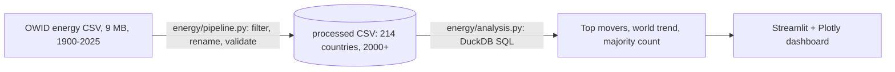

# Electricity Transition Dashboard

**Question:** which countries are decarbonising their electricity fastest, and is it coming from renewables or nuclear?

This is an interactive dashboard and analysis pipeline built on [Our World in Data's energy dataset](https://github.com/owid/energy-data), covering 214 countries from 2000 to 2024. It uses **Python, pandas, DuckDB (SQL), Streamlit and Plotly**.


## Key findings (2015 → 2024)

- **The world's electricity got cleaner, but fossil fuels still dominate.** The low-carbon share of global electricity rose from **33.5% to 40.9%**, and fossil generation fell from **66.5% to 59.1%**. Almost all of the gain came from renewables, which went from 23.0% to 31.9%.
- **The fastest movers took different routes.** Among grids generating at least 10 TWh a year:

  | Country | Low-carbon share 2015 → 2024 | Change | Driven by |
  |---|---|---|---|
  | Portugal | 47.6% → 85.2% | +37.6 pts | Renewables |
  | Netherlands | 16.3% → 53.7% | +37.4 pts | Renewables |
  | Belarus | 1.0% → 37.3% | +36.3 pts | Nuclear (+34.2 pts) |
  | Venezuela | 58.8% → 91.1% | +32.3 pts | Renewables |
  | United Arab Emirates | 0.2% → 31.7% | +31.5 pts | Mostly nuclear (+22.9 pts) |
  | Chile | 43.2% → 70.0% | +26.8 pts | Renewables |

- **About half of sizeable grids now run mostly on low-carbon power:** 53 of the 108 countries generating 10 TWh or more.
- **Recommendation for reading these numbers:** a share can rise because fossil generation *falls*, not only because clean generation *grows*. Large jumps, such as Venezuela's, should be checked against absolute generation (TWh) before being called a clean-energy success. The dashboard shows both.

These figures are produced by `energy/analysis.py`, so they update when the data is refreshed.

## Run it locally

You need Python 3.12 or newer.

```bash
git clone https://github.com/Riya-086/energy-transition-dashboard.git
cd energy-transition-dashboard
python -m venv .venv
source .venv/bin/activate          # Windows: .venv\Scripts\activate
pip install -r requirements.txt
streamlit run app.py
```

The dashboard opens at http://localhost:8501. The processed dataset is included (`data/processed/electricity_mix.csv`, 430 KB), so no download is needed.

To pull the latest data from Our World in Data and rebuild the table:

```bash
python -m energy.pipeline --refresh
```

## What's inside



| Dashboard section | What it shows |
|---|---|
| Headline metrics | World low-carbon and fossil share with change since the chosen year; countries with a majority low-carbon grid |
| Biggest increases | Ranked bar chart splitting each country's gain into renewables and nuclear |
| Over time | Low-carbon share for any countries you pick, against the world |
| Grid mix | Coal, gas, nuclear, hydro, wind and solar shares for one country |

The sidebar filters cover the start year, a minimum grid size, and which countries to chart.

## Tests

```bash
pip install -r requirements-dev.txt
pytest
```

- **Pipeline:** aggregates such as "Europe" are dropped, World is kept, and data before 2000 is removed.
- **Analysis:** ranking, the renewables/nuclear split, and the small-grid filter, checked on a hand-made dataset with known answers.
- **Data:** integrity checks on the shipped processed file.
- **Dashboard:** it renders without errors and handles an empty selection, using Streamlit's built-in app tester.

GitHub Actions runs lint, format checks and all tests on every push.

## Method and limitations

- **Low-carbon** means renewables (hydro, wind, solar, bioenergy and other renewables) plus nuclear, as defined by Our World in Data.
- These are shares of **electricity generation**, not total energy use, so transport and heating are not covered.
- Grids under 10 TWh are excluded from rankings by default, because a single new plant can swing their shares (adjustable in the sidebar).
- 2024 is the latest year with data for at least 100 countries. 2025 figures exist for some countries but are partial.
- The source data is compiled by Our World in Data from Ember and the Energy Institute, under the CC BY 4.0 licence.
